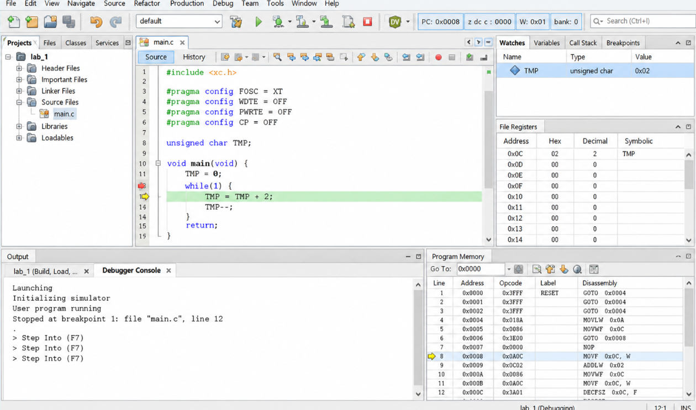

# Лабораторна робота № 1

**Виконала:** Половко Аліна  
**Група:** КН-42

## Тема роботи

Ознайомлення із середовищем розробки MPLAB X IDE та відлагоджувачем Simulator.

## Мета роботи

Ознайомитися з інтерфейсом та основними можливостями інтегрованого середовища розробки MPLAB X IDE. Навчитися створювати проєкти для мікроконтролера PIC16F84A, компілювати програми мовою C за допомогою компілятора XC8 та виконувати покрокове відлагодження програм у симуляторі.

## Хід виконання роботи

### 1. Підготовка середовища розробки

Для виконання лабораторної роботи використано середовище MPLAB X IDE версії 6.35 та компілятор XC8 версії 3.10.

У репозиторії `microcontrollers` створено папку `Labs`, у якій розміщено папку `lab_1`. Для зручності роботи в ній передбачено дві підпапки:

- `Source` — для зберігання вихідного коду програми.
- `Documentation` — для зберігання звіту та результатів виконання лабораторної роботи.

### 2. Створення проєкту

У середовищі MPLAB X IDE створено новий проєкт за допомогою команди **File → New Project**.

Під час налаштування проєкту виконано такі дії:

1. Обрано категорію Microchip Embedded та тип Application Project.
2. Вибрано мікроконтролер PIC16F84A.
3. Як інструмент відлагодження встановлено Simulator.
4. Обрано компілятор XC8 версії 3.10.
5. Вказано назву проєкту та місце його збереження.

Після завершення налаштувань створено структуру проєкту, у якій можна додавати файли з програмним кодом і виконувати їх компіляцію.

### 3. Написання програмного коду

У розділі Source Files створено файл `main.c`, у якому написано програму мовою C.

У програмі підключено бібліотеку `xc.h`, налаштовано конфігураційні біти мікроконтролера та оголошено глобальну змінну `TMP`.

**Лістинг програми `main.c`:**

```c
#include <xc.h>

#pragma config FOSC = XT
#pragma config WDTE = OFF
#pragma config PWRTE = OFF
#pragma config CP = OFF

unsigned char TMP;

void main(void)
{
    TMP = 0;

    while (1)
    {
        TMP = TMP + 2;
        TMP--;
    }
}
```

**Пояснення програмного коду:**

- `#include <xc.h>` — підключення бібліотеки для роботи з мікроконтролером.
- `#pragma config` — налаштування конфігураційних параметрів мікроконтролера.
- `unsigned char TMP` — оголошення глобальної змінної розміром 8 бітів.
- `void main(void)` — головна функція програми.
- `TMP = 0` — встановлення початкового значення змінної.
- `while (1)` — організація нескінченного циклу.
- `TMP = TMP + 2` — збільшення значення змінної на 2.
- `TMP--` — зменшення значення змінної на 1.

Після кожної повної ітерації циклу значення змінної `TMP` збільшується на одиницю, оскільки спочатку до неї додається 2, а потім віднімається 1.

### 4. Компіляція програми

Після написання програмного коду виконано компіляцію проєкту за допомогою команди **Clean and Build Main Project**.

Для компіляції використано компілятор XC8.

Після успішної збірки у вікні Output відображається повідомлення:

`BUILD SUCCESSFUL`

Це повідомлення свідчить про успішне завершення процесу збірки проєкту.

### 5. Відлагодження програми

Для перевірки роботи програми використано вбудований симулятор Simulator у середовищі MPLAB X IDE.

Відлагодження запускається за допомогою команди **Debug Main Project**.

У вікні Watches додано глобальну змінну `TMP`, що дозволяє спостерігати за зміною її значення під час виконання програми.

Покрокове виконання здійснюється за допомогою клавіші **F7 (Step Into)**.

Під час відлагодження перевіряється виконання арифметичних операцій і робота нескінченного циклу. Це дозволяє простежити, як змінюється значення змінної після кожної операції.

## Результати симуляції

Під час покрокового виконання програми досліджено зміну значення змінної `TMP`.

| Крок | Операція | Значення TMP |
|---:|---|---:|
| 1 | `TMP = 0` | 0 |
| 2 | `TMP = TMP + 2` | 2 |
| 3 | `TMP--` | 1 |
| 4 | `TMP = TMP + 2` | 3 |
| 5 | `TMP--` | 2 |
| 6 | `TMP = TMP + 2` | 4 |
| 7 | `TMP--` | 3 |

Результати показують, що після кожного повного проходження циклу значення змінної збільшується на одиницю.

**Скріншот результатів симуляції:**


Тут потрібно вставити скриншот із MPLAB X IDE, на якому видно виконання програми та значення змінної `TMP` у вікні Watches.

## Вихідний контроль

### 1. Яке призначення середовища MPLAB X IDE?

MPLAB X IDE — це інтегроване середовище розробки програмного забезпечення для мікроконтролерів Microchip. Воно використовується для написання програм, створення проєктів, компіляції програмного коду, програмування мікроконтролерів і відлагодження програм.

### 2. Для чого використовується програмний симулятор (Simulator)?

Програмний симулятор Simulator призначений для моделювання роботи мікроконтролера без використання фізичного пристрою. Він дозволяє виконувати програму покроково, переглядати значення змінних, аналізувати стан регістрів і перевіряти правильність роботи програмного коду.

### 3. Яку роль відіграє нескінченний цикл while(1) у програмах для мікроконтролерів?

Нескінченний цикл `while(1)` забезпечує постійне повторення команд програми. Він використовується для організації основного робочого процесу мікроконтролера, який повинен безперервно виконувати задані операції.

## Висновок

Під час виконання лабораторної роботи я ознайомилася з основними можливостями середовища розробки MPLAB X IDE та симулятора Simulator. Я створила проєкт для мікроконтролера PIC16F84A, розглянула структуру програми мовою C та принцип роботи компілятора XC8.

Також я ознайомилася з покроковим відлагодженням програми та спостереженням за зміною значення глобальної змінної `TMP`. У результаті роботи я краще зрозуміла, як створювати проєкти для мікроконтролерів, перевіряти програмний код і використовувати симулятор для аналізу виконання команд.
