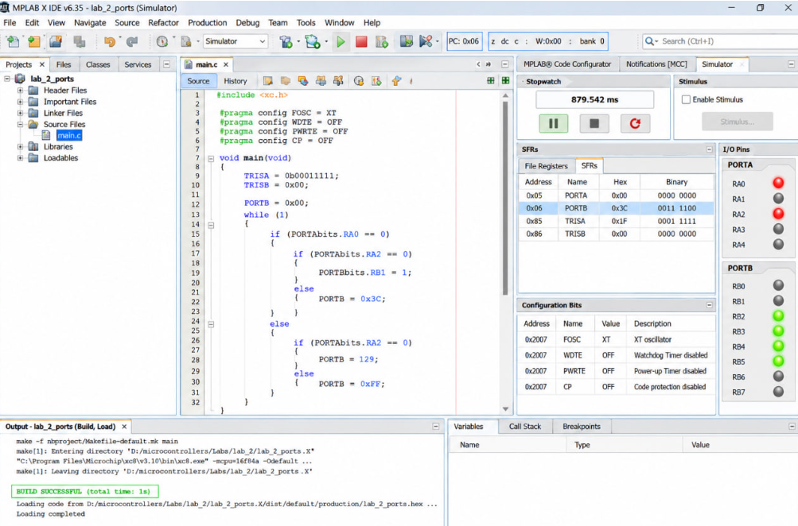
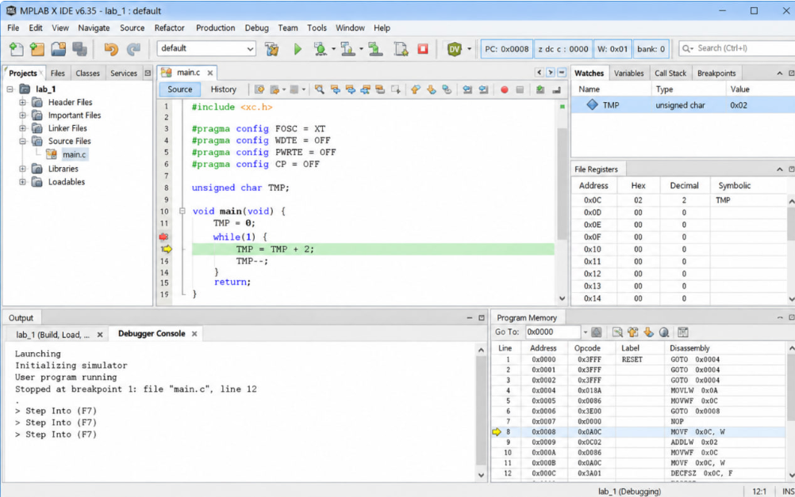
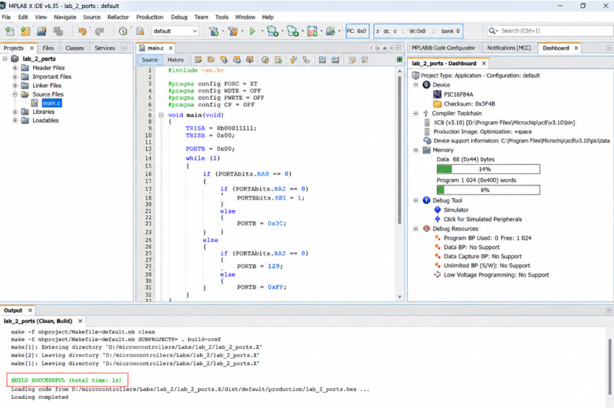
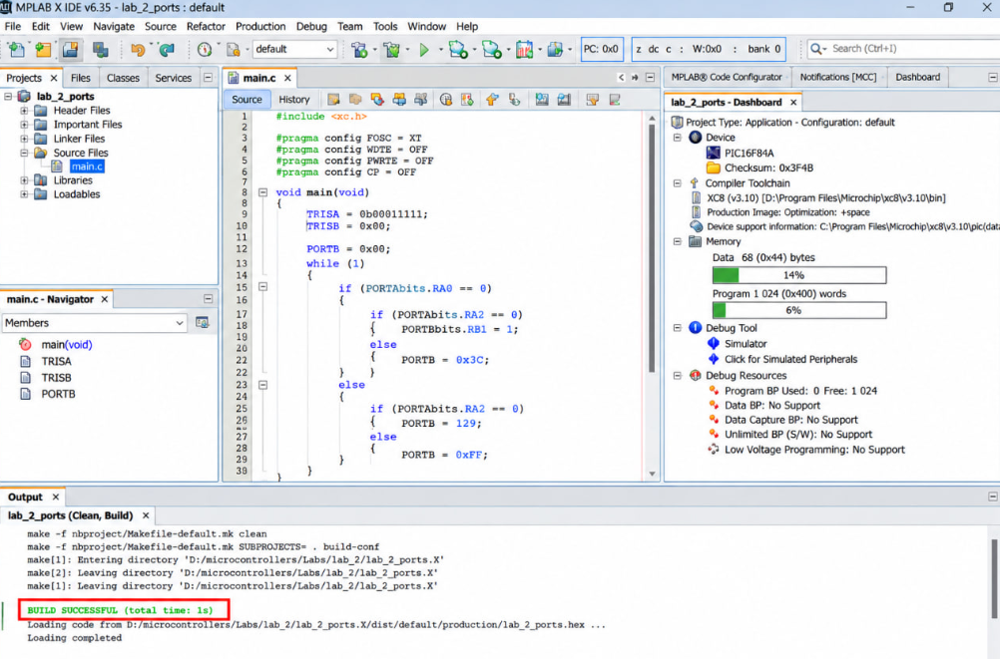

# Лабораторна робота № 2

**Виконала:** Половко Аліна  
**Група:** КН-42

**Навчальна дисципліна:** Мікроконтролери та їх програмування

## Тема роботи

Робота з портами вводу/виводу. Моделювання в Proteus VSM. Кодовий замок.

## 1. Мета роботи

На прикладі мікроконтролера PIC16F84A ознайомитися з режимами роботи портів вводу/виводу та особливостями їх налаштування. Розглянути принципи введення і виведення дискретних сигналів, навчитися моделювати електронні схеми в середовищі Proteus VSM та дослідити принцип роботи кодового замка.

## 2. Завдання

1. Налаштувати програму для роботи з портами мікроконтролера PIC16F84A.
2. Створити проєкт у MPLAB X IDE, скомпілювати програмний код та отримати HEX-файл.
3. Створити в Proteus VSM схему з мікроконтролером PIC16F84A, вісьмома світлодіодами та двома перемикачами.
4. Підключити HEX-файл і перевірити роботу схеми відповідно до заданого алгоритму.
5. Розглянути програму кодового замка з опитуванням клавіатури, перевіркою введеного коду та керуванням вихідними пристроями.
6. Дослідити моделювання роботи кодового замка в Proteus VSM.

## 3. Хід виконання роботи

### 3.1. Частина 1. Робота з портами вводу/виводу

Під час виконання першої частини лабораторної роботи розглянуто роботу портів вводу/виводу мікроконтролера PIC16F84A.

Мікроконтролер має два основні порти вводу/виводу:

- **PORTA** — п'ятирозрядний порт, який використовується для приймання та передавання цифрових сигналів.
- **PORTB** — восьмирозрядний порт, який дає змогу керувати зовнішніми пристроями, наприклад світлодіодами.

Напрямок роботи виводів визначається за допомогою регістрів `TRISA` та `TRISB`. Значення `1` відповідає режиму введення, а значення `0` — режиму виведення.

### 3.2. Створення електронної схеми

Для моделювання роботи портів у середовищі Proteus VSM необхідно створити електронну схему з мікроконтролером, світлодіодами, резисторами та перемикачами.

Для схеми використовуються такі компоненти:

| Компонент | Кількість |
|---|---:|
| PIC16F84A | 1 |
| LED-YELLOW | 8 |
| Резистор 150 Ом | 8 |
| Резистор 10 кОм | 2 |
| Перемикач SWITCH | 2 |

Кнопка Кн1 підключається до виводу RA0, а кнопка Кн2 — до RA2. Світлодіоди підключаються до виводів RB0–RB7.

Для кнопок використовуються підтягувальні резистори. У ненатиснутому стані на вході встановлюється логічна одиниця, а під час натискання — логічний нуль.

У властивостях мікроконтролера потрібно вказати шлях до згенерованого HEX-файлу та встановити тактову частоту 4 МГц.

**Скріншот 1. Електронна схема в Proteus VSM**


Тут потрібно вставити власний скриншот створеної схеми з мікроконтролером, світлодіодами, резисторами та перемикачами.

### 3.3. Ініціалізація портів

Для налаштування напрямку роботи портів використовуються такі команди:

```c
TRISA = 0b00011111;
TRISB = 0x00;
```

Регістр `TRISA` налаштовує виводи порту A на введення сигналів.

Регістр `TRISB` налаштовує всі вісім виводів порту B на виведення сигналів.

Це дозволяє використовувати PORTA для зчитування станів кнопок, а PORTB — для керування світлодіодами.

### 3.4. Алгоритм роботи програми

У програмі використовується нескінченний цикл, у якому постійно перевіряється стан двох кнопок.

Основна логіка програми має такий вигляд:

```c
while (1)
{
    if (K1 == 0)
    {
        if (K2 == 0)
            PORTBbits.RB1 = 1;
        else
            PORTB = 0x3C;
    }
    else
    {
        if (K2 == 0)
            PORTB = 129;
        else
            PORTB = 0xFF;
    }
}
```

У цьому фрагменті програми `K1` і `K2` позначають стан кнопок відповідно до їх налаштування в програмі.

Залежно від стану кнопок на порт B передаються різні значення, які визначають комбінацію ввімкнених світлодіодів.

### 3.5. Очікувані результати симуляції

Після запуску симуляції комбінація світлодіодів залежить від стану кнопок Кн1 і Кн2.

| Кнопка Кн1 | Кнопка Кн2 | Значення PORTB | Результат |
|---|---|---|---|
| Не натиснута | Не натиснута | `0xFF` | Усі 8 світлодіодів увімкнені |
| Не натиснута | Натиснута | `129` | Світлодіоди RB7 та RB0 |
| Натиснута | Не натиснута | `0x3C` | Світлодіоди RB5, RB4, RB3 та RB2 |
| Натиснута | Натиснута | `RB1 = 1` | Встановлюється логічна одиниця на RB1, інші біти зберігають попередній стан |

За допомогою цієї програми можна перевірити роботу цифрових портів мікроконтролера та дослідити керування світлодіодами залежно від стану кнопок.

**Скріншот 2. Результат моделювання роботи портів**


Тут потрібно вставити власний скриншот із Proteus VSM, на якому видно стан світлодіодів під час роботи схеми.

## 4. Частина 2. Розробка кодового замка

### 4.1. Принцип роботи кодового замка

У другій частині лабораторної роботи розглядається принцип роботи кодового замка на основі мікроконтролера PIC16F84A.

Пристрій працює за принципом перевірки введеної користувачем кодової комбінації. Мікроконтролер послідовно опитує кнопки клавіатури, зберігає введені значення та порівнює їх із кодом, записаним у пам'яті програми.

Якщо код введено правильно, вмикається світлодіод, який сигналізує про успішну перевірку, та активується реле. Якщо введена комбінація неправильна, вмикається інший світлодіод, що сигналізує про помилку.

### 4.2. Підключення компонентів

Для роботи кодового замка використовуються такі виводи мікроконтролера:

| Вивід | Призначення |
|---|---|
| RB3 | Кнопка Кн1 |
| RB2 | Кнопка Кн2 |
| RB1 | Кнопка Кн3 |
| RB0 | Кнопка Кн4 |
| RB4 | Кнопка OK |
| RB5 | Кнопка CLR |
| RA0 | Світлодіод правильного коду |
| RA1 | Світлодіод помилки |
| RA2 | Керування реле |

Кнопки підключаються з використанням підтягувальних резисторів номіналом 10 кОм.

**Скріншот 3. Схема кодового замка в Proteus VSM**


Тут потрібно вставити власний скриншот схеми кодового замка з мікроконтролером, кнопками, світлодіодами та реле.

### 4.3. Алгоритм роботи кодового замка

Робота кодового замка складається з кількох етапів:

1. Мікроконтролер перевіряє стан кнопок Кн1–Кн4.
2. Після натискання кнопки програма очікує її відпускання.
3. Інформація про натискання зберігається в пам'яті.
4. Після натискання кнопки OK введена комбінація порівнюється зі збереженим кодом.
5. Якщо код правильний, активуються світлодіод RA0 та реле RA2.
6. Якщо код неправильний, активується світлодіод RA1.
7. Кнопка CLR очищає введені дані та вимикає виходи.

Такий алгоритм дозволяє перевіряти правильність введення коду та керувати вихідними пристроями залежно від результату перевірки.

### 4.4. Формування кодової комбінації

Для збереження натискань використовується байтове представлення даних.

Старша тетрада містить порядковий номер натискання, а молодша — код натиснутої кнопки.

Коди кнопок:

- Кн1 — `0001`
- Кн2 — `0010`
- Кн3 — `0100`
- Кн4 — `1000`

У програмі передбачено перевірку PIN-коду `1223`.

Приклад оголошення масиву із записаними значеннями коду:

```c
const unsigned char PIN_CODE[4] = {
    0x11, 0x22, 0x32, 0x44
};
```

Для збереження натискань використовується функція `add_key()`:

```c
static void add_key(unsigned char mask)
{
    if (count < MAX_LEN)
        entered[count] =
            (unsigned char)(((count + 1) << 4) | mask);

    if (count < 255)
        count++;
}
```

Функція зберігає код натиснутої кнопки разом із порядковим номером натискання. Це дозволяє враховувати послідовність введення символів.

### 4.5. Перевірка введеного коду

Для перевірки правильності введеної комбінації використовується умовний оператор:

```c
if (codes_match())
{
    LED_OK = 1;
    LED_ERR = 0;
    RELAY = 1;
}
else
{
    LED_OK = 0;
    LED_ERR = 1;
    RELAY = 0;
}
```

Якщо введений код збігається зі збереженим, програма вмикає світлодіод правильного коду та активує реле.

Якщо код неправильний, світлодіод правильного коду вимикається, а світлодіод помилки вмикається. Реле при цьому залишається вимкненим.

### 4.6. Очікувані результати роботи кодового замка

| Дія користувача | Результат |
|---|---|
| Ввести 1, 2, 2, 3 та натиснути OK | Увімкнення RA0 та реле RA2 |
| Ввести неправильний код | Увімкнення RA1 |
| Натиснути CLR | Очищення введеного коду та вимкнення виходів |
| Ввести 1, 3, 2, 2 | Помилка через неправильний порядок введення |

Отже, під час роботи кодового замка враховується не лише набір натиснутих кнопок, а й порядок їх натискання.

**Скріншот 4. Результат симуляції кодового замка**


Тут потрібно вставити власний скриншот із Proteus VSM, який демонструє результат перевірки введеного коду.

## 5. Вихідний контроль

### 1. Яке призначення та функціональні особливості портів PIC16F8X?

Порти вводу/виводу забезпечують обмін інформацією між мікроконтролером і зовнішніми пристроями.

PORTA має п'ять розрядів, а PORTB — вісім. Кожен вивід можна налаштувати на введення або виведення даних. Порт B також підтримує внутрішні підтягувальні резистори та переривання при зміні сигналів на RB4–RB7.

### 2. Для чого призначені регістри TRISA, TRISB, PORTA та PORTB?

Регістри TRISA та TRISB визначають напрямок роботи виводів портів. Значення `1` відповідає режиму введення, а `0` — режиму виведення.

Регістри PORTA та PORTB використовуються для зчитування цифрових сигналів і керування вихідними станами портів.

### 3. Як відбувається процес модифікації біта порту?

Модифікація біта порту виконується за принципом «читання — зміна — запис». Спочатку зчитується поточний стан порту, потім змінюється потрібний біт, після чого оновлене значення записується назад.

### 4. Як відбувається опитування стану кнопки?

Кнопка підключається до входу мікроконтролера з використанням підтягувального резистора.

У ненатиснутому стані на вході присутній логічний рівень `1`, а після натискання — `0`.

Програма перевіряє стан входу за допомогою умовного оператора `if` та виконує відповідні дії залежно від результату перевірки.

### 5. Як створити проєкт на основі мікроконтролера у Proteus VSM?

Спочатку потрібно створити електронну схему, додати мікроконтролер та інші компоненти з бібліотеки Proteus, розмістити їх на робочому полі й з'єднати відповідно до схеми.

Після цього у властивостях мікроконтролера необхідно вибрати HEX-файл, налаштувати тактову частоту та запустити симуляцію для перевірки роботи схеми.

### 6. Як працює типовий кодовий замок на основі мікроконтролера?

Мікроконтролер опитує клавіатуру, приймає введений код і порівнює його зі значенням, збереженим у пам'яті програми.

Якщо комбінація правильна, формується сигнал для відкривання замка. Якщо код неправильний, доступ не надається та може вмикатися сигналізація помилки.

### 7. Як працює досліджуваний кодовий замок?

Користувач вводить код за допомогою кнопок Кн1–Кн4 та підтверджує його кнопкою OK.

Якщо код правильний, вмикається світлодіод RA0 і активується реле RA2. Якщо код неправильний, вмикається світлодіод RA1.

Кнопка CLR призначена для очищення введеної комбінації та вимкнення вихідних пристроїв.

### 8. Яка особливість опитування кнопок клавіатури кодового замка?

Програма послідовно перевіряє кнопки клавіатури та очікує відпускання кожної натиснутої кнопки. Це дозволяє уникнути багаторазового врахування одного натискання.

Кожне натискання зберігається разом із його порядковим номером, тому послідовність введення символів впливає на результат перевірки коду.

## 6. Висновок

Під час виконання лабораторної роботи я ознайомилася з особливостями роботи портів вводу/виводу мікроконтролера PIC16F84A та призначенням регістрів TRISA, TRISB, PORTA і PORTB. Я розглянула принципи приймання та передавання цифрових сигналів, а також керування світлодіодами залежно від стану кнопок.

У другій частині роботи я ознайомилася з принципом роботи кодового замка, який перевіряє правильність введеної комбінації з урахуванням порядку натискання кнопок. Також я розглянула призначення кнопок OK і CLR та принцип керування світлодіодами й реле.

У результаті виконання лабораторної роботи я краще зрозуміла, як використовуються порти мікроконтролера для взаємодії із зовнішніми пристроями та як можна моделювати роботу цифрових схем у середовищі Proteus VSM.
