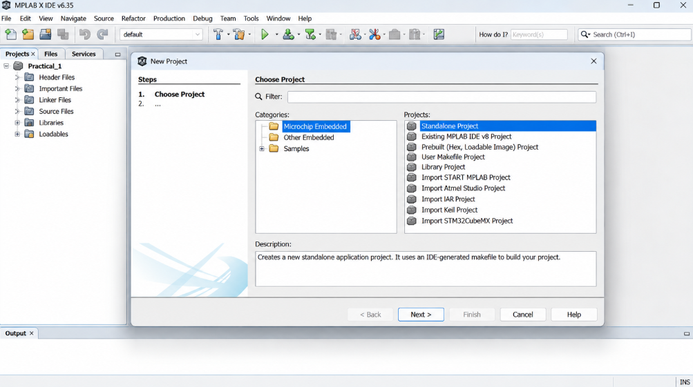
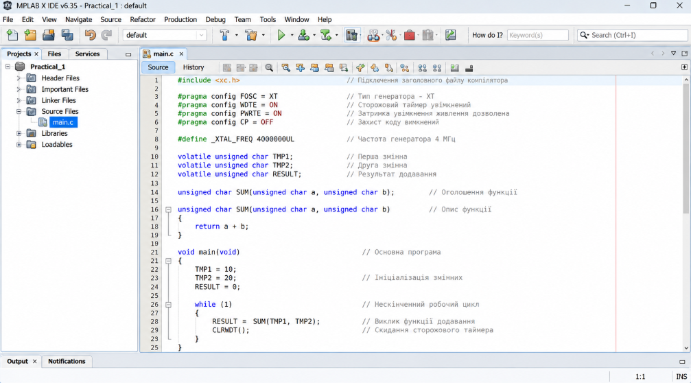
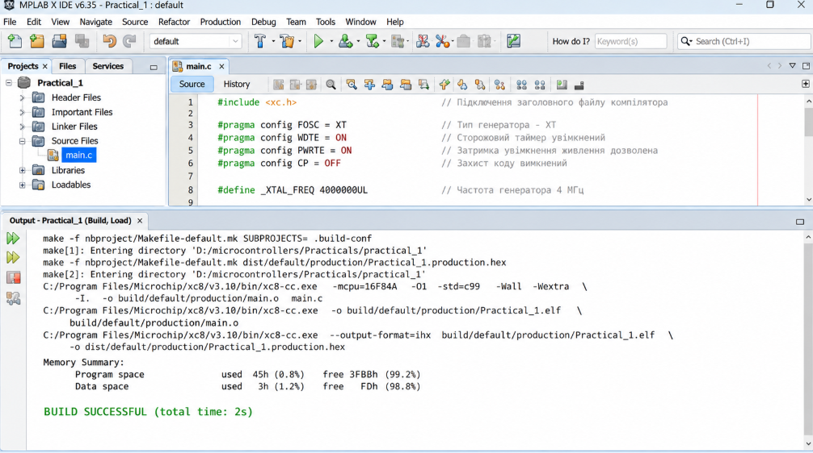
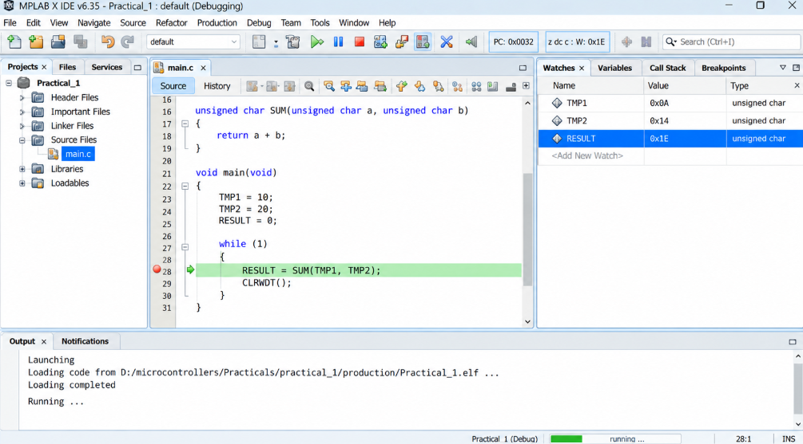

# ВСП Фаховий коледж інформаційних технологій
# Національного університету «Львівська політехніка»

**Практична робота № 1**

**Тема:** Конфігурування мікроконтролера. Написання і відлагодження програм в середовищі MPLAB.

**Виконала:** студентка групи КН-42 Половко Аліна Романівна

**Львів — 2026**

---

## Тема

Конфігурування мікроконтролера. Написання і відлагодження програм в середовищі MPLAB.

## Мета роботи

Навчитися працювати з регістром конфігурації мікроконтролера. Закріпити знання синтаксису написання програм у середовищі MPLAB.

## Завдання

1. Вивчити призначення регістра конфігурації мікроконтролера PIC16F84A.
2. Ознайомитися із синтаксичними правилами написання програм у середовищі MPLAB для MPASM та HI-TECH PICC.
3. Сформувати слово конфігурації для двох варіантів.
4. Задати біти конфігурації за допомогою директиви CONFIG для MPASM.
5. Задати біти конфігурації для HI-TECH PICC.
6. Написати програму мовою C для PIC16F84A зі змінними TMP1, TMP2 та функцією SUM.
7. Виконати відлагодження програми.
8. Дати письмові відповіді на контрольні запитання.

## Використані засоби

- Мікроконтролер PIC16F84A.
- MPLAB X IDE.
- Компілятор MPLAB XC8.
- Мова програмування C.
- Мова асемблера.
- Симулятор MPLAB.

## 3. Налаштування регістра CONFIG

Регістр CONFIG мікроконтролера PIC16F84A призначений для встановлення основних режимів роботи мікроконтролера.

Слово конфігурації розташоване за адресою 2007h у пам'яті програм.

### 3.1. Призначення бітів конфігурації

- **CP** — захист програмного коду.
- **PWRTE** — дозвіл затримки під час увімкнення живлення.
- **WDTE** — дозвіл роботи сторожового таймера.
- **FOSC1:FOSC0** — вибір типу тактового генератора.

### 3.2. Варіант 1

Параметри конфігурації:

- Захист коду вимкнений (CP = 1).
- Затримка увімкнення живлення дозволена (PWRTE = 0).
- Сторожовий таймер увімкнений (WDTE = 1).
- Генератор XT (FOSC1:FOSC0 = 01).

Значення молодших п'яти бітів: `10101`.

Слово конфігурації: `0x3FF5`.

### 3.3. Варіант 2

Параметри конфігурації:

- Захист коду увімкнений (CP = 0).
- Затримка увімкнення живлення вимкнена (PWRTE = 1).
- Сторожовий таймер вимкнений (WDTE = 0).
- Генератор RC (FOSC1:FOSC0 = 11).

Значення молодших п'яти бітів: `01011`.

Слово конфігурації: `0x3FEB`.

### 3.4. Конфігурація для MPASM

**Варіант 1:**

```asm
#include <P16F84A.INC>
    __CONFIG 0x3FF5
```

**Варіант 2:**

```asm
#include <P16F84A.INC>
    __CONFIG 0x3FEB
```

### 3.5. Конфігурація для XC8

**Варіант 1:**

```c
#pragma config FOSC = XT
#pragma config WDTE = ON
#pragma config PWRTE = ON
#pragma config CP = OFF
```

**Варіант 2:**

```c
#pragma config FOSC = RC
#pragma config WDTE = OFF
#pragma config PWRTE = OFF
#pragma config CP = ON
```

У сучасному компіляторі XC8 використовується директива `#pragma config` замість застарілого макросу `CONFIG()`, наведеного для HI-TECH PICC.

## 4. Хід виконання роботи

### 4.1. Конфігурування мікроконтролера

Під час виконання практичної роботи я обрала мікроконтролер PIC16F84A та ознайомилася з призначенням регістра CONFIG. Він визначає основні параметри роботи мікроконтролера: тип тактового генератора, роботу сторожового таймера, затримку ввімкнення живлення та захист програмного коду.

Також я розглянула два варіанти конфігурації відповідно до завдання.

Для реалізації програми мовою C було обрано варіант 1 із такими параметрами:

- Генератор XT.
- Сторожовий таймер WDT увімкнений.
- Затримка увімкнення живлення дозволена.
- Захист програмного коду вимкнений.

### 4.2. Створення програми мовою C

Я підготувала файл `Source/main.c` для мікроконтролера PIC16F84A.

Програма містить:

1. Заголовний файл `xc.h`.
2. Директиви конфігурації `#pragma config`.
3. Оголошення змінних `TMP1`, `TMP2`, `RESULT`.
4. Оголошення та визначення функції `SUM()`.
5. Основну функцію `main()`.
6. Ініціалізацію змінних.
7. Нескінченний робочий цикл `while(1)`.

### 4.3. Опис алгоритму програми

Алгоритм роботи програми складається з таких кроків:

1. Початок виконання програми.
2. Ініціалізація змінної `TMP1` значенням 10.
3. Ініціалізація змінної `TMP2` значенням 20.
4. Виклик функції `SUM(TMP1, TMP2)`.
5. Додавання двох чисел.
6. Запис результату у змінну `RESULT`.
7. Скидання сторожового таймера.
8. Повторення робочого циклу.

### 4.4. Очікуваний результат

Початкові значення змінних:

```c
TMP1 = 10;
TMP2 = 20;
```

Результат обчислення:

```c
RESULT = TMP1 + TMP2;
RESULT = 10 + 20;
RESULT = 30;
```

Отже, очікуване значення змінної `RESULT` становить **30**.

### 4.5. Відлагодження програми

Для перевірки програми передбачено використання MPLAB X IDE та інструмента Simulator.

Під час відлагодження необхідно:

1. Створити проєкт для PIC16F84A.
2. Додати файл `main.c`.
3. Виконати компіляцію за допомогою XC8.
4. Запустити програму в режимі Debug.
5. Переглянути значення змінних `TMP1`, `TMP2` та `RESULT`.
6. Переконатися, що `RESULT` дорівнює 30.

## 5. Ілюстрації до роботи

**Рисунок 1 — Створення проєкту для PIC16F84A у MPLAB X IDE.**


**Рисунок 2 — Програмний код main.c у середовищі MPLAB X IDE.**


**Рисунок 3 — Результат компіляції програми.**



**Рисунок 4 — Перевірка значення RESULT у вікні Watches.**



## 6. Контрольні запитання

### 1. Для чого призначені регістри?

Регістри — це комірки пам'яті мікроконтролера, які призначені для тимчасового зберігання даних, адрес, результатів обчислень та інформації про стан пристрою. Вони забезпечують швидкий обмін інформацією між внутрішніми компонентами мікроконтролера.

### 2. Для чого призначений регістр CONFIG? За якою адресою знаходиться? Чи можна зчитати його вміст?

Регістр CONFIG призначений для налаштування режимів роботи мікроконтролера, зокрема вибору тактового генератора, увімкнення або вимкнення сторожового таймера, затримки запуску живлення та захисту програмного коду.

У мікроконтролері PIC16F84A слово конфігурації розташоване за адресою 2007h у пам'яті програм.

Його вміст не можна зчитувати звичайними командами програми під час роботи мікроконтролера. Доступ до конфігураційних бітів здійснюється в режимі програмування за допомогою програматора.

### 3. Як відбувається редагування макроса CONFIG?

Редагування макроса CONFIG здійснюється шляхом зміни параметрів конфігурації у вихідному коді програми.

Для HI-TECH PICC використовувався макрос `CONFIG()`, у якому необхідні параметри поєднувалися оператором `&`.

У сучасному компіляторі XC8 конфігураційні біти задаються директивами `#pragma config`.

Приклад:

```c
#pragma config FOSC = XT
#pragma config WDTE = ON
#pragma config PWRTE = ON
#pragma config CP = OFF
```

Після зміни параметрів необхідно повторно скомпілювати програму.

### 4. Яка структура програми в середовищі MPLAB?

Програма складається з основних частин:

1. Заголовна частина.
2. Оголошення констант і змінних.
3. Оголошення функцій.
4. Опис функцій.
5. Основна робоча частина програми.
6. За потреби — обробники переривань.

Для програми мовою асемблера виділяють три основні секції: заголовок, робочу секцію та секцію закінчення.

### 5. Що розміщується у заголовку програми?

У заголовку програми розміщуються директиви підключення файлів, налаштування конфігурації мікроконтролера, визначення констант, регістрів та інших необхідних ресурсів.

Наприклад, для програми мовою C:

```c
#include <xc.h>

#pragma config FOSC = XT
#pragma config WDTE = ON
#pragma config PWRTE = ON
#pragma config CP = OFF
```

### 6. Яке призначення файлу pic.h?

Файл `pic.h` використовувався компілятором HI-TECH PICC для підключення описів мікроконтролера.

Він забезпечував доступ до назв регістрів, окремих бітів, конфігураційних констант та спеціальних макросів.

У сучасному компіляторі MPLAB XC8 використовується заголовний файл `xc.h`, який підключає відповідні визначення для обраного мікроконтролера.

### 7. Що записується у робочій частині програми?

У робочій частині програми записуються команди, які реалізують основний алгоритм роботи мікроконтролера.

Це можуть бути математичні обчислення, операції з регістрами, перевірка умов, керування портами, виклики функцій та циклічне виконання команд.

У розробленій програмі робоча частина викликає функцію `SUM()`, записує результат додавання у змінну `RESULT` та скидає сторожовий таймер.

### 8. Який оператор мови C реалізує конструкцію робочої частини програми?

Для організації нескінченного робочого циклу мікроконтролера використовується оператор `while(1)`.

Приклад:

```c
while (1) {
    RESULT = SUM(TMP1, TMP2);
    CLRWDT();
}
```

Цикл забезпечує постійне виконання основного алгоритму програми.

## 7. Висновок

Під час виконання практичної роботи я ознайомилася з призначенням регістра конфігурації CONFIG мікроконтролера PIC16F84A та особливостями встановлення його конфігураційних бітів.

Я розглянула два варіанти конфігурації, які відрізняються налаштуваннями захисту програмного коду, сторожового таймера, затримки ввімкнення живлення та типу тактового генератора.

Також я ознайомилася зі структурою програми мовою C, змінними `TMP1` і `TMP2`, функцією `SUM()` та нескінченним робочим циклом. Для заданих початкових значень очікуваний результат додавання становить 30.

У результаті роботи я закріпила знання структури програм для PIC16F84A, використання конфігураційних директив і основних конструкцій мови C.
